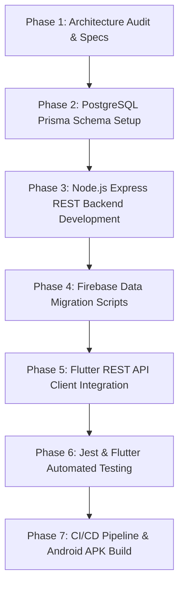

# TaleemPlus — Firebase to PostgreSQL Migration Plan

> **Goal:** Complete architectural decoupling from Firebase, replacing Auth and Firestore with a Node.js + Express REST API and PostgreSQL database via Prisma ORM.

---

## 1. Phased Migration Blueprint

---

## 2. Detailed Work Breakdown

### Phase 1: Specifications & Documentation
* Generate `PROJECT_AUDIT.md`, `OLD_ARCHITECTURE.md`, `DATABASE_DESIGN.md`, `API_DESIGN.md`, `SECURITY_AUDIT.md`.

### Phase 2 & 3: Node.js + Express + Prisma Backend (`taleemplus_backend/`)
* Initialize Node.js Express application.
* Define `prisma/schema.prisma` covering 18 relational models.
* Implement JWT Access Token (15m expiry) and Refresh Token rotation middleware.
* Create controllers, services, routes, and Zod validators for:
  - Auth (`/api/v1/auth/register`, `/login`, `/refresh`, `/me`, `/password-reset`)
  - Users & Academies (`/api/v1/users`, `/academies`, `/approval-requests`)
  - Classes & Sections (`/api/v1/classes`, `/sections`, `/academic-structure`)
  - Attendance (`/api/v1/attendance`)
  - Fee Challans & Analytics (`/api/v1/fees`)
  - Quizzes & Grading (`/api/v1/quizzes`, `/marks`)
  - Resources & Queries (`/api/v1/resources`, `/queries`)
  - Notifications & Timetables (`/api/v1/notifications`, `/timetables`)

### Phase 4: Migration Tooling (`scripts/`)
* `export_firebase.js`: Exports Cloud Firestore collections to local JSON files.
* `migrate_firebase_to_postgres.js`: Transforms JSON documents into PostgreSQL database records via Prisma.
* `verify_migration.js`: Compares collection record counts and validates foreign key integrity.

### Phase 5: Flutter Frontend Integration (`lib/`)
* Introduce `ApiClient` using `http` package for authorization header management and token refresh handling.
* Replace Firebase Remote Services (`auth_service.dart`, `quiz_service.dart`, etc.) with REST endpoints.
* Refactor Providers (`AuthProvider`, `MemberProvider`, `FeeProvider`, etc.) to bind to REST repositories.
* Verify 100% preservation of on-device AI engines (`FeeRiskModel`, `PerformanceIndexModel`, `TextRankSummarizer`, `TfIdfGrader`) and Google ML Kit OCR scanner.

### Phase 6 & 7: Testing, CI/CD & Android Packaging
* Write Jest integration test suite in `taleemplus_backend/tests/`.
* Run `flutter test` for on-device ML and UI bindings.
* Configure GitHub Actions workflows (`backend-ci.yml`, `flutter-ci.yml`, `android-apk.yml`).
* Build Release APK artifact (`v0.6.0+1`).
* Commit and push changes to `feature/firebase-to-node-postgresql`.
